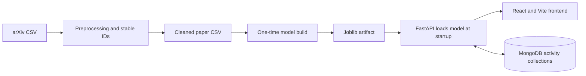

# ResearchPaper AI

A research paper finder built around a simple question: **if I have found one useful paper, what should I read next?**

The project indexes arXiv paper titles and abstracts, lets readers search by topic or phrase, and recommends related papers from the same corpus. It is a content-based recommender: it compares text, rather than learning from clicks or user ratings.

## What it does

- Search papers by title or research keywords.
- Open a paper's title, abstract, and categories.
- Find similar papers and see their cosine similarity scores.
- Save papers, keep search history, and store research interests for the current browser session when MongoDB is available.
- Continue searching and getting recommendations when MongoDB is offline; activity storage is then unavailable.

The interface is a React/Vite application. The API is FastAPI, and scikit-learn handles text vectorization and ranking. MongoDB stores activity only; the paper collection is not copied into the database.

## How the pieces fit together



The fitted recommender is loaded once when FastAPI starts. API requests transform the query and rank it against the existing sparse matrix; they do not fit the model again. MongoDB is a separate activity store and is optional for paper search and recommendations.

### Repository map

```text
researchpaper-ai/
├── researchpaper_ai/
│   ├── data.py                 # CSV parsing, cleaning, Paper records, IDs
│   ├── preprocess.py           # preprocessing command
│   ├── engine.py               # TF-IDF retrieval and optional clustering
│   ├── model_artifact.py       # artifact build/load and validation
│   ├── api.py                  # FastAPI app and HTTP routes
│   └── mongo_store.py          # optional activity persistence
├── scripts/
│   ├── build_model_artifact.py
│   ├── evaluate_recommender.py
│   └── compare_recommenders.py
├── tests/                      # Python API, data, model, and store tests
├── frontend/
│   ├── src/                    # React screens, components, API client, styles
│   ├── tests/                  # Node built-in test runner tests
│   ├── package.json
│   └── vite.config.js
├── data/                       # source CSVs and generated cleaned CSV
├── artifacts/                  # locally built recommender.joblib (gitignored)
├── reports/                    # evaluation outputs
├── requirements.txt
└── PROJECT_CONTEXT.md           # detailed project decisions and audit history
```

## Dataset and preparation

The selected source is `data/arxiv_data_210930-054931.csv`, with `terms`, `titles`, and `abstracts` columns. The source file is left unchanged. The preprocessing step writes `data/processed/papers_clean.csv`.

The input has 56,181 rows. Cleaning removes 15,054 exact duplicate rows, merges 7 records with the same normalized title and abstract while combining their tags, and keeps same-title records when their abstracts differ. No records were removed for having unusable text. The resulting corpus contains **41,120 papers**.

`terms` is parsed using `ast.literal_eval` and type checks; the code does not use `eval()`. Text is normalized with Unicode NFKC and whitespace collapse. Each internal ID is `paper_` followed by a SHA-256 digest of the normalized, case-folded title and abstract. IDs are deterministic, but they are internal IDs: the source CSV does not provide arXiv paper IDs.

To regenerate the cleaned CSV from the original source:

```powershell
python -m researchpaper_ai.preprocess
```

## Recommendation method

The current recommendation path is deliberately lightweight and inspectable:

1. The title is included twice and the abstract once, giving title terms more influence.
2. `TfidfVectorizer` uses English stop words, unigrams and bigrams, `min_df=2`, sublinear term frequency, `float32`, and a 150,000-feature cap.
3. The normalized TF-IDF matrix stays sparse. Its measured shape is **41,120 × 150,000**, with **5,454,716 non-zero values**.
4. A search query is transformed with the fitted vectorizer. A selected paper uses its existing row as the query vector.
5. Cosine similarity ranks the corpus. The selected paper is excluded from its own recommendations, and ties use a stable order.

Only one query-to-corpus score vector is produced per request; the implementation does not build a dense all-pairs matrix. Blank and out-of-vocabulary queries return no results. The API maps an unknown paper ID to HTTP 404.

### Clustering experiment

`MiniBatchKMeans` was evaluated with 30 clusters, batch size 1,024, 100 iterations, three initializations, and seed 42. The sampled cosine silhouette was **0.005541**, which is close to zero. Cluster-aware reranking produced more diverse lists in the measured evaluation but reduced both category-overlap relevance measures. Clustering remains an experiment; it is not used by the default recommendation route.

## Evaluation and what the numbers mean

The checked-in evaluation report uses 500 fixed-seed paper queries. Relevance is approximated by whether two papers share at least one `terms` value. This is a weak proxy—not a human judgment and not model accuracy.

| Ranking method | Precision@10 | Recall@10 | Intra-list diversity |
|---|---:|---:|---:|
| TF-IDF cosine baseline | 0.933400 | 0.000373 | 0.898795 |
| Cluster-aware reranking | 0.871600 | 0.000346 | 0.936327 |

The proxy can treat unrelated papers as relevant when their broad categories overlap. The query sample is not a temporal holdout or user study. These results do not establish real-world recommendation quality; they show the trade-off measured with the available labels. See `reports/phase2_evaluation.json` for the recorded run and cluster inspection.

Run the evaluation again with:

```powershell
python scripts/evaluate_recommender.py
```

## Run locally

The checked-in `.python-version` and `requirements.txt` pin the Python and backend package versions used for the current artifact. In PowerShell, from the project root:

```powershell
python -m venv .venv
.\.venv\Scripts\Activate.ps1
python -m pip install -r requirements.txt
if (-not (Test-Path .env)) { Copy-Item .env.example .env }
```

The API expects the fitted artifact at `artifacts/recommender.joblib` by default. If it is not present, build it once after preprocessing:

```powershell
python -m researchpaper_ai.preprocess
python scripts/build_model_artifact.py
```

Building fits the vectorizer and writes the artifact; starting the API only loads it. The artifact is intentionally gitignored. A deployment must be given the artifact at the configured path, or build it from the cleaned CSV as an explicit build step. Treat Joblib artifacts as trusted Python data; do not load files from untrusted sources.

Start the backend from the repository root:

```powershell
uvicorn researchpaper_ai.api:app --reload
```

In another PowerShell terminal:

```powershell
cd frontend
if (-not (Test-Path .env)) { Copy-Item .env.example .env }
npm.cmd ci
npm.cmd run dev
```

Open the local Vite address shown in the terminal, usually `http://localhost:5173`. The frontend's API URL is `VITE_API_BASE_URL`; its local example points to `http://127.0.0.1:8000`.

### Configuration

The root `.env.example` and `frontend/.env.example` are templates. They contain no credentials. Keep real values in ignored environment files or the hosting provider's secret settings; do not commit them.

| Variable | Used by | Purpose |
|---|---|---|
| `MONGODB_URI` | Backend | MongoDB connection string; defaults to local MongoDB |
| `MONGODB_DATABASE` | Backend | Activity database name |
| `MONGODB_SERVER_SELECTION_TIMEOUT_MS` | Backend | Mongo server-selection timeout |
| `CORS_ORIGINS` | Backend | Comma-separated allowed browser origins |
| `MODEL_ARTIFACT_PATH` | Backend and builder | Location of the fitted Joblib artifact |
| `CLEANED_DATA_PATH` | Builder | Cleaned CSV used when building the artifact |
| `VITE_API_BASE_URL` | Frontend | FastAPI origin embedded in the Vite build |

For local use, the API permits the two common Vite origins. In a hosted setup, configure `VITE_API_BASE_URL` with the backend URL and set `CORS_ORIGINS` to the frontend's exact origin. Do not use the local example values in production.

## API overview

FastAPI's interactive API reference is available at `/docs` while the server is running.

| Method | Route | Purpose |
|---|---|---|
| `GET` | `/health` | Model and MongoDB availability |
| `GET` | `/papers/search?q=...&limit=...` | Search and, when possible, record the query |
| `GET` | `/papers/{paper_id}` | Return paper details |
| `GET` | `/papers/{paper_id}/recommendations?k=10` | Return similar papers and similarity scores |
| `POST` | `/session/bookmarks` | Save a paper for the current session |
| `GET` | `/session/bookmarks` | List saved papers |
| `DELETE` | `/session/bookmarks/{paper_id}` | Remove a saved paper |
| `GET` | `/session/search-history` | Read recent session searches |
| `GET` | `/session/interests` | Read saved session interests |
| `PUT` | `/session/interests` | Replace saved session interests |

Search query length is limited to 1–512 characters; search limits and recommendation `k` are 1–50. Activity-list limits are 1–100. Invalid input returns HTTP 422, and unknown papers return HTTP 404. Recommendation values are cosine similarity scores—not probabilities or accuracy.

## Activity storage and session behavior

MongoDB stores only three kinds of activity: bookmarks, search history, and research interests. Paper text and the 41,120-record corpus stay in the model artifact and cleaned dataset.

The browser uses an anonymous session ID for activity requests. It is a label for local/session-based behavior, **not a login or secure authentication mechanism**; a caller can choose or spoof an ID. Do not use it as account security or assume it provides private multi-user isolation.

If MongoDB is unavailable, `/health` reports a degraded state. Search and recommendations remain available, but activity routes return HTTP 503 and search responses indicate that history was not saved. There is no automatic retention policy for activity documents; plan cleanup appropriate to your use.

## Tests and current verification

From the project root:

```powershell
python -m pytest -q
```

From `frontend/`:

```powershell
npm.cmd test
npm.cmd run build
```

Latest recorded local verification: **25 backend tests passed**, **5 frontend tests passed**, and the production Vite build succeeded. The Python run reports one non-failing Starlette/HTTPX deprecation warning. Tests cover backend logic and frontend API/session/bookmark helpers; they do not replace a live MongoDB persistence check or a browser-based accessibility and responsive-layout review.

## Current limitations

- There are no human-annotated relevance judgments or user-study results.
- The category field is multi-label and inconsistent; category overlap is only a weak evaluation proxy.
- Internal paper IDs are content-derived because the source does not provide a paper ID column.
- Anonymous session IDs are not authentication.
- MongoDB persistence depends on a separately configured MongoDB service.
- The fitted artifact is excluded from Git and must be supplied or built before API startup.
- K-Means did not demonstrate a recommendation-quality improvement over the baseline in the measured proxy evaluation.

This is an MCA project demonstrating a complete, explainable retrieval pipeline—from CSV preparation to API and user interface—with clear limits on what its current evaluation can claim.
